<div align="center">

<!-- ═════════════ BANNER ═════════════
     ADD: a banner image (1200x300) at docs/images/banner.png, or keep the placeholder. -->


# 📡 Reliable File Transfer over UDP with SDN Rerouting

**UDP guarantees nothing. We add the guarantees. The SDN controller keeps the road open.**

[](https://www.python.org/)
[](http://mininet.org/)
[](https://ryu-sdn.org/)
[](https://opennetworking.org/)
[](#tests)
[](#requirements)
<!-- OPTIONAL: add a License badge once you pick a license:
[](LICENSE) -->

[Quick Start](#quick-start) · [Architecture](#architecture) · [Demos](#demo-gallery) · [Results](#results) · [Troubleshooting](#troubleshooting)

</div>

---

## Table of Contents

1. [Overview](#overview)
2. [Key Features](#key-features)
3. [Project Phases](#project-phases)
4. [Architecture](#architecture)
5. [Protocol Design](#protocol-design)
6. [What UDP Lacks and What We Built](#what-udp-lacks-and-what-we-built)
7. [Repository Layout](#repository-layout)
8. [Requirements](#requirements)
9. [Installation](#installation)
10. [Quick Start](#quick-start)
11. [Command Reference](#command-reference)
12. [Use Cases and Recipes](#use-cases-and-recipes)
13. [Demo Gallery](#demo-gallery)
14. [Results](#results)
15. [Reading the Output](#reading-the-output)
16. [Tests](#tests)
17. [Reproducing on Another Machine](#reproducing-on-another-machine)
18. [Troubleshooting](#troubleshooting)
19. [Limitations](#limitations)
20. [Team and Contributions](#team-and-contributions)
21. [Acknowledgements](#acknowledgements)

---

## Overview

A file-transfer program that sends files over **UDP**, a protocol that by itself guarantees nothing.
The **application** adds the guarantees: every chunk is numbered and acknowledged, lost chunks are
resent, duplicates are ignored, and a **SHA-256** hash proves the received file is identical to the original.

The transfer runs on a **Mininet** virtual network with **two routes** between sender and receiver.
A **Ryu SDN controller** watches the links, moves traffic to the backup route when the primary fails,
and moves it back when the link returns.

> [!IMPORTANT]
> **Division of responsibility:** the *application* repairs lost **data**; the *controller* repairs broken **paths**.
> Neither replaces the other.

| Problem | Who solves it | How |
|---|---|---|
| Packet lost, duplicated, or out of order | 🐍 The application (Python) | Sequence numbers, ACKs, retransmission, duplicate detection, hashing |
| Link or switch stops working | 🌐 The SDN controller (Ryu) | Detects failure, rewrites flow rules to use the other route |

<!-- ADD: a 10-20 second GIF of the whole system working (failover during a transfer).
     Save as docs/images/demo.gif and uncomment the line below. -->
<!-- <p align="center"></p> -->

---

## Key Features

- 🔌 **Raw UDP sockets** with an application-level protocol: sequence numbers, ACKs, timeouts with retries, duplicate and gap detection, CRC32 per packet, SHA-256 per file.
- 🔁 **Two sender algorithms:** stop-and-wait (D1) and Selective Repeat with an adaptive timeout (D2).
- 👥 **Multi-sender receiver:** one receiver socket serves several senders at once.
- 🗺️ **Mininet topology** with a primary and a backup route, configurable bandwidth, delay and loss.
- 🧠 **Two Ryu controllers:** static (D1) and dynamic (D2) with monitoring, reroute, recovery, port statistics and application reports.
- 🔇 **Silent-failure handling:** the sender reports repeated timeouts to the controller over a Unix socket.
- 📊 **Automated experiments** that write CSV, plus a script that turns the CSV into graphs.
- ✅ **22 tests** (unit + end-to-end) that run without Mininet.

---

## Project Phases

| Phase | Goal | What is demonstrated |
|---|---|---|
| **D1** | Working basic system | Reliable stop-and-wait transfer through Mininet with the D1 controller installing static rules. Normal transfer and transfer under packet loss, both with matching hashes. |
| **D2** | Dynamic SDN and measurement | Selective Repeat sender, link failure during a transfer with automatic reroute and recovery, application-triggered reroute for silent failures, several senders at once, automated experiments with graphs. |

---

## Architecture

### Three layers

```text
┌──────────────────────────────────────────────────────────────────────┐
│ APPLICATION   sender.py / sender_sr.py  <->  receiver.py             │
│ Fixes LOST DATA: sequence numbers, ACKs, retransmission,             │
│ duplicate/gap detection, CRC32 per packet, SHA-256 per file          │
└──────────────────────────────────────────────────────────────────────┘
                                     │  UDP datagrams, port 5005
                                     ▼
┌──────────────────────────────────────────────────────────────────────┐
│ NETWORK       Mininet hosts h1, h2, h3  +  Open vSwitch s1..s4       │
│ Carries or drops packets; makes no routing decisions                 │
└──────────────────────────────────────────────────────────────────────┘
                                     ▲
                                     │  OpenFlow 1.3 over TCP 6653
┌──────────────────────────────────────────────────────────────────────┐
│ CONTROL       Ryu: controller_d1.py (D1)  or  controller.py (D2)     │
│ Fixes BROKEN PATHS: flow rules, port events, reroutes                │
└──────────────────────────────────────────────────────────────────────┘

   Side channel (D2 only): sender -> Unix socket /tmp/sdn_notify.sock -> controller
```

### Network topology

```text
                          ┌────── s2 ──────┐
                          │  2 ms    2 ms  │      PRIMARY   s1 - s2 - s4
                          │                │      cost 1+1, RTT about 12 ms
 h1 10.0.0.1 ─┐           │                │      used while healthy
              ├── s1 ─────┤                ├───── s4 ──── h2 10.0.0.2
 h3 10.0.0.3 ─┘           │                │                (receiver)
                          │ 10 ms    10 ms │      BACKUP    s1 - s3 - s4
                          │                │      cost 5+5, RTT about 44 ms
                          └┄┄┄┄┄┄ s3 ┄┄┄┄┄┄┘      used after the primary fails

 ───  primary route        ┄┄┄  backup route        (host links: 1 ms each)
```

| Route | Path | Cost | One-way core delay | Approx. h1→h2 RTT | Used when |
|---|---|---|---|---|---|
| **Primary** | s1 → s2 → s4 | 1 + 1 | 2 + 2 ms | ~12 ms | the network is healthy |
| **Backup** | s1 → s3 → s4 | 5 + 5 | 10 + 10 ms | ~44 ms | the primary has failed |

> 💡 The ping time tells you which route is active: about 12 ms means primary, about 44 ms means backup.

<details>
<summary><b>📌 Port map and link table (click to expand)</b></summary>

| Switch | Port 1 | Port 2 | Port 3 | Port 4 |
|---|---|---|---|---|
| s1 | h1 | s2 (primary) | s3 (backup) | h3 |
| s2 | s1 | s4 | n/a | n/a |
| s3 | s1 | s4 | n/a | n/a |
| s4 | s2 | s3 | h2 | n/a |

| Link | Ports | Cost | Delay | Role |
|---|---|---|---|---|
| s1–s2 | s1:2, s2:1 | 1 | 2 ms | primary |
| s2–s4 | s2:2, s4:1 | 1 | 2 ms | primary |
| s1–s3 | s1:3, s3:1 | 5 | 10 ms | backup |
| s3–s4 | s3:2, s4:2 | 5 | 10 ms | backup |
| h1–s1, h3–s1, h2–s4 | host ports | n/a | 1 ms | access |

Loss (with `--loss`) is applied only to the two links leaving s1, so each route has exactly one lossy hop.

</details>

<!-- ADD: your own topology screenshot (e.g. output of `net` / `links` in the Mininet CLI) -->
<p align="center">
  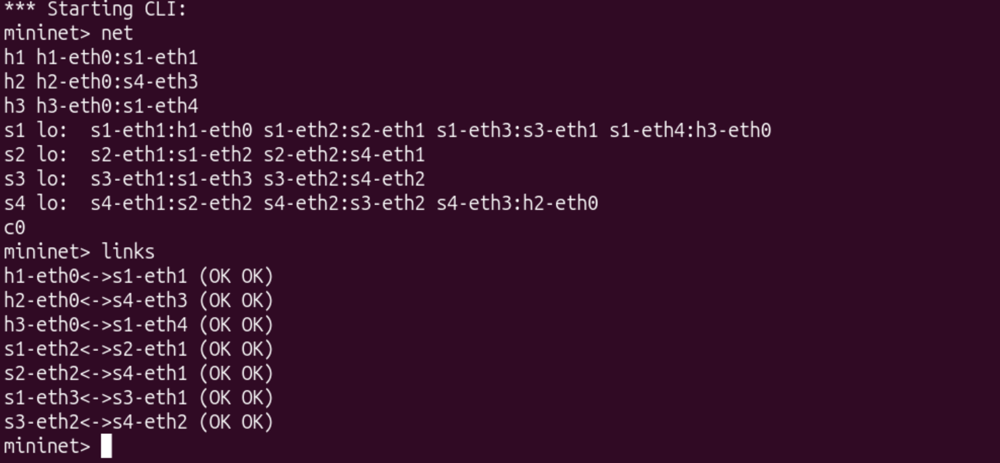
  <br/><sub>📸 <b>Figure 1.</b> Mininet topology as built by <code>sdn/topology.py</code>.</sub>
</p>

### Controller comparison

| Component | `controller_d1.py` (D1) | `controller.py` (D2) |
|---|---|---|
| Class | `StaticPathController` | `RerouteController` |
| On switch connect | installs rules for the primary route | installs rules for the current best route |
| Link-failure detection | none | `EventOFPPortStatus` from the switch |
| Reroute | none | recompute routes, rewrite rules on every switch |
| Recovery | none | reroutes back when both ends of a link are up |
| Monitoring | none | port stats every 2 s to `port_stats.csv` |
| Application reports | none | listens on `/tmp/sdn_notify.sock` |
| Static baseline | n/a | `REROUTE=0` logs events but never reroutes |

### Controller event flow (D2)

```text
┌────────────────────────────────────┐    ┌────────────────────────────────────┐
│ Switch port goes down              │    │ Sender reports path_problem        │
│ EventOFPPortStatus event           │    │ after 5 consecutive timeouts       │
└────────────────────────────────────┘    └────────────────────────────────────┘
                   │                                         │
                   ▼                                         ▼
┌────────────────────────────────────┐    ┌────────────────────────────────────┐
│ down_ports.add(s1, port 2)         │    │ _notify_loop: suspect link         │
└────────────────────────────────────┘    │ for 15 s (5 s cooldown)            │
                                          └────────────────────────────────────┘
                   │                                         │
                   └────────────────────┬────────────────────┘
                                        ▼
         ┌────────────────────────────────────────────────────────────┐
         │ routing.next_hops(down_links)                              │
         │ Dijkstra shortest path with failed links removed           │
         └────────────────────────────────────────────────────────────┘
                                        │
                                        ▼
         ┌────────────────────────────────────────────────────────────┐
         │ install_flows(dp) on every switch                          │
         │ same match, new output port (overwrites the old rule)      │
         └────────────────────────────────────────────────────────────┘
                                        │
                                        ▼
         ┌────────────────────────────────────────────────────────────┐
         │ REROUTE logged + row added to controller_events.csv        │
         └────────────────────────────────────────────────────────────┘
```

> **Why rules are replaced, not deleted:** an OpenFlow ADD with the same match and priority overwrites the old entry,
> so rerouting is a single new rule per destination with no window where the destination has no rule.

### Failure timeline

| Time | Event | Who reacts | Result |
|---|---|---|---|
| t0 | `link s1 s2 down` | Open vSwitch | ports 2 on s1 and s2 report link-down |
| t0 + ms | `EventOFPPortStatus` | controller | `LINK_DOWN` logged, reroute computed |
| t0 + ms | new flow rules | controller → switches | s1 sends h2 traffic out port 3 |
| t0 + ms | packets in flight are lost | network | sender sees no ACKs |
| t0 + 0.5 s | timeout | sender | `TIMEOUT` logged, chunk retransmitted |
| t0 + 0.5 s | retransmission arrives via backup | network | ACK returns, transfer continues |
| t1 | `link s1 s2 up` | Open vSwitch | ports report link-up |
| t1 + ms | `LINK_UP` and `REROUTE ... s1-s2-s4` | controller | traffic returns to the primary |

For **silent failures** (`--blackhole-at`) the port never goes down, so the controller sees nothing.
After `NOTIFY_AFTER = 5` consecutive timeouts the sender reports `path_problem`, and the controller avoids the
first core link of the current route for 15 s (5 s cooldown).

---

## Protocol Design

Every datagram starts with a **15-byte header** (network byte order, `struct` format `!BIIHI`):

```
 byte:  0         1                   5                   9        11                  15
       ┌─────────┬───────────────────┬───────────────────┬────────┬───────────────────┬──────────────┐
       │  type   │   transfer_id     │       seq         │ length │      crc32        │   payload    │
       │ 1 byte  │     4 bytes       │     4 bytes       │ 2 bytes│     4 bytes       │ 0..1000 bytes│
       └─────────┴───────────────────┴───────────────────┴────────┴───────────────────┴──────────────┘
```

The CRC32 covers the header (crc field zeroed) plus payload. Largest datagram = 15 + 1000 = **1015 bytes**,
below the 1500-byte MTU, so IP never fragments.

| Type | Value | Sent by | `seq` means | Payload | Purpose |
|---|---|---|---|---|---|
| `START` | 1 | sender | 0 | file size (8 B), chunk count (4 B), SHA-256 (32 B), file name | announce transfer, tell the receiver the expected hash |
| `DATA` | 2 | sender | chunk index 0..N−1 | up to 1000 file bytes | carry one chunk |
| `ACK` | 3 | receiver | the seq acknowledged | empty | "I have this chunk" |
| `FIN` | 4 | sender | 0 | empty | "all chunks acknowledged, please verify" |
| `FIN_ACK` | 5 | receiver | 0 | `PASS` or `FAIL` | SHA-256 comparison result |

> A packet with an unknown type, wrong length or bad CRC is treated **exactly like a lost packet**: `protocol.unpack()` returns `None` and it is dropped.

### Transfer sequence (stop-and-wait, one chunk and one ACK lost)

```text
     Sender (h1)                                    Receiver (h2)
          │                                               │
          │────── START (size, chunks, SHA-256, name) ───▶│   session created
          │◀──────────────────── ACK 0 ───────────────────│
          │────────────────── DATA seq=0 ────────────────▶│   stored
          │◀──────────────────── ACK 0 ───────────────────│
          │────────────────── DATA seq=1 ────X            │   lost on the way
          │              ... 0.5 s timeout ...            │
          │─────────── DATA seq=1  (RETRANSMIT) ─────────▶│   stored
          │◀──────────────────── ACK 1 ───────────────────│
          │────────────────── DATA seq=2 ────────────────▶│   stored
          │            X──────── ACK 2 ───────────────────│   ACK lost on the way
          │              ... 0.5 s timeout ...            │
          │─────────── DATA seq=2  (RETRANSMIT) ─────────▶│   DUP: ignored, not written twice
          │◀──────────────────── ACK 2 ───────────────────│   re-ACKed
          │            ... remaining chunks ...           │
          │────────────────────── FIN ───────────────────▶│   all chunks present? write file, check SHA-256
          │◀─────────────── FIN_ACK  "PASS" ──────────────│
          │                                               │
```

### Sender algorithms

| Aspect | `sender.py` (stop-and-wait, D1) | `sender_sr.py` (Selective Repeat, D2) |
|---|---|---|
| Packets in flight | 1 | up to `--window` (default 16) |
| Timer | one fixed timeout (0.5 s) | one timer per packet |
| Timeout value | fixed | adaptive: smoothed RTT + 4 × variance, clamped 0.2 to 2.0 s |
| Backoff | none | doubles on each timeout event, capped at 2 s |
| RTT samples | n/a | only from packets sent once (Karn's rule) |
| Retry limit | `MAX_RETRIES` = 15 per packet | 15 per packet, then abort |
| Speed | one round trip per chunk | window fills the link |

### Key design decisions

| Decision | Reason |
|---|---|
| SHA-256 sent inside START | the receiver cannot verify a file it never had |
| CRC32 per packet | a corrupt packet is handled like a lost one |
| One ACK per DATA packet | the receiver is identical for D1 and D2 |
| Stop-and-wait in D1, Selective Repeat in D2 | a window makes gap detection real |
| Proactive flow rules + static ARP | the topology has a loop; a learning switch would flood ARP forever |
| `failMode=secure` on switches | with no controller, switches drop traffic instead of looping |
| Unix socket for app → controller | Mininet hosts share the filesystem but cannot reach the controller IP |
| Loss only on s1's links | each route has one lossy hop, so loss % is comparable |

---

## What UDP Lacks and What We Built

| # | UDP gap | What we built | Implemented in | Quick verify |
|---|---|---|---|---|
| 1 | No way to move a file | Sender + receiver over `SOCK_DGRAM`, port 5005 | `sender.py`, `receiver.py`, `protocol.py` | [UC2](#uc2-transfer-on-localhost-no-mininet-no-ryu) |
| 2 | No ordering | `seq` field in every DATA packet | `protocol.py`, `sender.py` | `sender.py ... -v` |
| 3 | No delivery confirmation | One ACK per received chunk, including repeats | `receiver.py`, `sender.py` | side-by-side logs |
| 4 | Lost datagrams vanish | 0.5 s deadline, resend up to 15 times | `sender.py`, `config.py` | [UC3](#uc3-prove-loss-is-recovered-localhost) |
| 5 | No duplicate/gap detection | Per-chunk record; `DUP` and `GAP` log lines | `receiver.py` | [UC4](#uc4-prove-duplicates-are-detected-lost-acks) |
| 6 | No integrity check | CRC32 per packet, SHA-256 per file | `protocol.py`, `receiver.py` | `sha256sum` |
| 7 | No network visibility | Port-status events plus app reports | `sdn/controller.py` | `link s1 s2 down` |
| 8 | No fallback path | Dijkstra reroute with failed links removed | `sdn/routing.py`, `flows.py`, `controller.py` | [UC7](#uc7-link-failure-during-a-transfer-d2) |

---

## Repository Layout

```
Reliable-File-Transfer-via-UDP/
├── config.py               shared constants: port, chunk size, timeouts, paths
├── protocol.py             packet format: pack/unpack, CRC, START body, hashing
├── notify.py               application -> controller message over a Unix socket
├── sender.py               stop-and-wait sender (D1) + shared building blocks
├── sender_sr.py            Selective Repeat sender (D2)
├── receiver.py             receiver for D1 and D2 (unchanged between phases)
├── sdn/
│   ├── net_config.py       single source of truth: hosts, ports, links, costs, delays
│   ├── routing.py          pure-Python Dijkstra with failed links removed
│   ├── flows.py            OpenFlow 1.3 helpers: add, delete, install rules
│   ├── topology.py         Mininet builder and CLI entry point
│   ├── controller_d1.py    D1 Ryu controller: static primary-route rules
│   └── controller.py       D2 Ryu controller: monitor, reroute, recover, app reports
├── scripts/
│   ├── harness.py          runs Mininet, injects faults, verifies hashes independently
│   ├── run_demo.py         one scripted demonstration run
│   ├── run_experiments.py  automated loss and failure suites -> CSV
│   └── plot_results.py     CSV -> PNG graphs
├── tests/                  test_protocol (7), test_routing (7), test_loopback (8)
├── sample_files/           input files (*.bin git-ignored; you create them)
├── received_files/         created by the receiver at run time (git-ignored)
├── logs/                   created at run time (git-ignored)
├── results/                experiment CSV and graphs (commit the final ones)
├── docs/                   <- ADD: images/ and screenshots/ folders for this README
├── requirements.txt
└── README.md
```

| File | Runs on | Started by | Needs root |
|---|---|---|---|
| `sender*.py`, `receiver.py` | your shell or a Mininet host | you or `harness.py` | no |
| `controller_d1.py`, `controller.py` | Ryu (own venv) | `ryu-manager` | no |
| `topology.py`, `run_demo.py`, `run_experiments.py` | Mininet | `sudo python3 ...` | **yes** |
| `plot_results.py`, `tests/` | any Python | `python3 ...` | no |

---

## Requirements

| Item | Requirement |
|---|---|
| Machine | 64-bit, at least 4 GB RAM, 10 GB free disk |
| OS | **Ubuntu 20.04 or 22.04** (VM or bare metal). Mininet needs the Linux kernel. |
| Privileges | `sudo` |
| Network | Internet during installation |

> The **unit and loopback tests run on any OS with Python 3.8+**. Only the Mininet and Ryu steps need Ubuntu.

| Software | Version | Used for | Install |
|---|---|---|---|
| Python 3 (system) | 3.8+ | sender, receiver, tests, Mininet scripts | preinstalled |
| Python 3.9 (Ryu venv) | 3.9 | runs Ryu | [Installation](#installation) |
| Mininet | Ubuntu package | virtual hosts, switches, links | `sudo apt install mininet` |
| Open vSwitch | Ubuntu package | software switches | `sudo apt install openvswitch-switch` |
| Ryu | 4.x with `eventlet==0.30.2` | SDN controller | pip |
| setuptools | 57.5.0 (Ryu install only) | builds Ryu's older dependencies | pip |
| tshark / Wireshark | any recent | packet capture evidence | `sudo apt install tshark` |
| matplotlib | any recent | graphs | `pip install -r requirements.txt` |

<details>
<summary><b>Why these exact pins?</b></summary>

- **Python 3.9 for Ryu:** tested with `eventlet==0.30.2`; newer eventlet releases break Ryu's event loop.
- **setuptools 57.5.0:** newer releases fail while building Ryu's older packages.
- **`--no-build-isolation`:** lets the pinned setuptools be used during the build.

</details>

---

## Installation

### Step 1: install networking tools

```bash
sudo apt update && sudo apt upgrade -y
sudo apt install -y mininet openvswitch-switch python3-pip python3-venv git tshark
sudo mn --test pingall      # expect: 0% dropped (2/2 received)
sudo mn -c
```

### Step 2: clone the repository

```bash
cd ~/Desktop
git clone https://github.com/gitaccgaurav/Reliable-File-Transfer-via-UDP.git
cd Reliable-File-Transfer-via-UDP
```

### Step 3: create the Python 3.9 environment for Ryu

<details>
<summary><b>Option A: deadsnakes PPA</b></summary>

```bash
sudo add-apt-repository -y ppa:deadsnakes/ppa
sudo apt update
sudo apt install -y python3.9 python3.9-venv python3.9-dev
python3.9 -m venv ~/ryuenv
```
</details>

<details>
<summary><b>Option B: uv (no PPA)</b></summary>

```bash
pip install --user uv
uv python install 3.9
uv venv --python 3.9 ~/ryuenv
```
</details>

```bash
source ~/ryuenv/bin/activate
python --version        # must print Python 3.9.x
```

### Step 4: install Ryu

```bash
pip install "setuptools==57.5.0" wheel
pip install --no-build-isolation "eventlet==0.30.2" ryu
which ryu-manager       # must be inside ~/ryuenv/bin/
python -c "import ryu, eventlet; print('ok', eventlet.__version__)"   # ok 0.30.2
```

### Step 5: plotting dependency and tests

```bash
deactivate
pip install --user -r requirements.txt
python3 -m unittest discover tests      # expect: Ran 22 tests ... OK
```

### Step 6: create sample files

```bash
mkdir -p sample_files
head -c 2000000 /dev/urandom > sample_files/2000KB.bin
head -c 300000  /dev/urandom > sample_files/300KB.bin
```

> Random binary data is deliberate: it proves the transfer is byte-exact, not just "looks like text".

<!-- ADD: screenshot of the passing test run -->
<p align="center">
  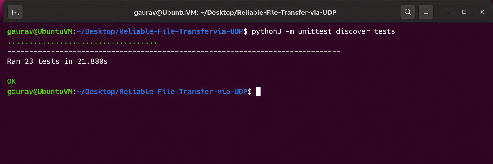
  <br/><sub>📸 <b>Figure 2.</b> All 22 tests passing.</sub>
</p>

---

## Quick Start

Mininet demos use **three terminals**. Order matters.

| Terminal | Purpose | Command |
|---|---|---|
| **T1** | Ryu controller (keep running) | `source ~/ryuenv/bin/activate` then `ryu-manager sdn/controller.py` |
| **T2** | Mininet and transfers | `sudo python3 sdn/topology.py` (system Python, **not** the venv) |
| **T3** | Evidence: flow tables, captures, logs | `sudo ovs-ofctl ...`, `sudo tshark ...`, `cat logs/...` |

```bash
# T2: clean leftovers (never while Ryu is running)
sudo mn -c

# T1: start the controller and leave it running
source ~/ryuenv/bin/activate
cd ~/Desktop/Reliable-File-Transfer-via-UDP
ryu-manager sdn/controller.py          # or sdn/controller_d1.py for D1

# T2: start the network
cd ~/Desktop/Reliable-File-Transfer-via-UDP
sudo python3 sdn/topology.py
```

Then at the `mininet>` prompt:

```
mininet> pingall                                    # expect 0% dropped (6/6)
mininet> h1 ping -c 3 h2                            # ~12 ms
mininet> h2 python3 receiver.py -v &
mininet> h1 python3 sender.py sample_files/300KB.bin 10.0.0.2 --name h1 -v
mininet> sh sha256sum sample_files/300KB.bin received_files/*_300KB.bin
```

**Success:** the sender's last line contains `"verdict": "PASS"` and both hashes are identical.

<!-- ADD: screenshots of T1 (controller connected) and T2 (pingall + transfer PASS) -->
| T1: controller | T2: Mininet transfer |
|:--:|:--:|
| 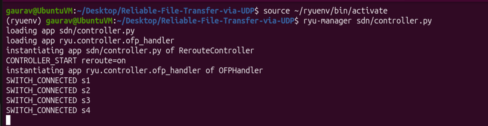 | 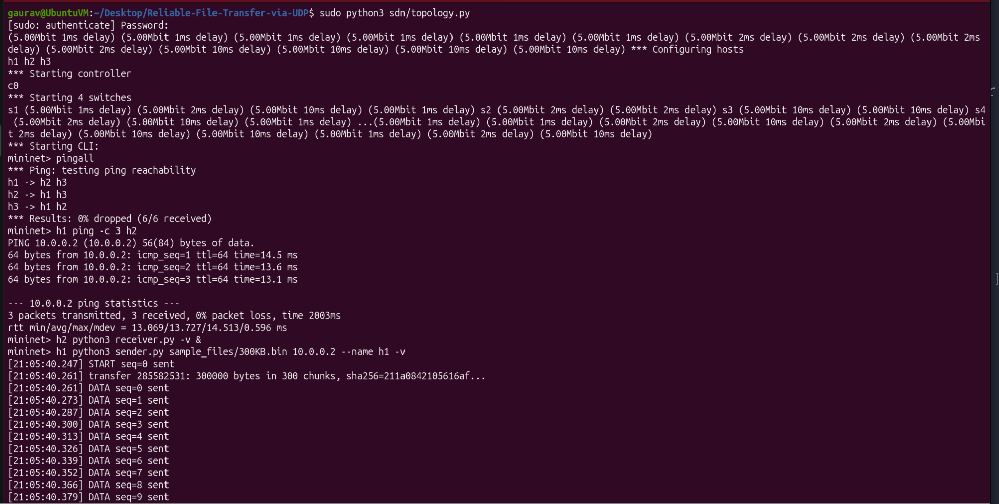 |

**Shut down:** `exit` in T2, `Ctrl+C` in T1, then `sudo mn -c`.

> [!WARNING]
> 1. Always start Ryu **before** the topology.
> 2. Never run `sudo mn -c` while Ryu is running.
> 3. Run Ryu from the repo root (it writes to `logs/`).
> 4. After a Mininet run, fix ownership: `sudo chown -R $USER:$USER logs received_files`.

### Send your own file

```bash
cp /path/to/file.pdf sample_files/         # avoid spaces in the name
```
```
mininet> h2 python3 receiver.py -v &
mininet> h1 python3 sender_sr.py sample_files/file.pdf 10.0.0.2 --name h1
mininet> sh sha256sum sample_files/file.pdf received_files/*_file.pdf
```

---

## Command Reference

<details open>
<summary><b>Senders</b>: <code>sender.py</code> and <code>sender_sr.py</code></summary>

```
python3 sender.py    FILE HOST [options]     # stop-and-wait
python3 sender_sr.py FILE HOST [options]     # Selective Repeat
```

| Option | Default | Meaning |
|---|---|---|
| `FILE` | n/a | file to send |
| `HOST` | n/a | receiver IP, e.g. `127.0.0.1` or `10.0.0.2` |
| `--port N` | 5005 | receiver UDP port |
| `--name LABEL` | `sender` | host label sent to the controller (`h1`, `h3`) |
| `--drop-rate P` | 0.0 | probability (0 to 1) of dropping each outgoing packet |
| `--no-notify` | off | never report to the controller |
| `--stats-file PATH` | none | also append result JSON to this file |
| `-v`, `--verbose` | off | print every packet sent |
| `--window N` | 16 | *(`sender_sr.py` only)* packets in flight |
</details>

<details>
<summary><b>Receiver</b>: <code>receiver.py</code></summary>

| Option | Default | Meaning |
|---|---|---|
| `--bind ADDR` | `0.0.0.0` | local address |
| `--port N` | 5005 | UDP port |
| `--out-dir DIR` | `received_files` | output folder |
| `--drop-ack P` | 0.0 | probability of dropping each outgoing ACK |
| `-v`, `--verbose` | off | log every stored DATA packet |
</details>

<details>
<summary><b>Topology and controllers</b></summary>

```bash
sudo python3 sdn/topology.py [--loss PERCENT] [--bw MBITS]     # defaults: 0, 5

ryu-manager sdn/controller_d1.py          # D1: static
ryu-manager sdn/controller.py             # D2: dynamic
REROUTE=0 ryu-manager sdn/controller.py   # D2 code, never reroutes (baseline)
```

| Option | Default | Meaning |
|---|---|---|
| `--loss PERCENT` | 0 | loss on the two links leaving s1 |
| `--bw MBITS` | 5 | bandwidth of every link |
| `REROUTE` (env) | 1 | `0` disables all route changes; events still logged |
</details>

<details>
<summary><b>Scripted demo</b>: <code>scripts/run_demo.py</code></summary>

```
sudo python3 scripts/run_demo.py FILE [options]
```

| Option | Default | Meaning |
|---|---|---|
| `--sender sw\|sr` | `sw` | stop-and-wait or Selective Repeat |
| `--loss PERCENT` | 0 | loss on s1's links |
| `--bw MBITS` | 5 | link bandwidth |
| `--fail-at SEC` | n/a | bring link s1–s2 down this many seconds after start |
| `--recover-at SEC` | n/a | bring it back up |
| `--blackhole-at SEC` | n/a | silently drop all IP traffic at s2 (link stays up) |
| `--unblackhole-at SEC` | n/a | remove the silent drop |
| `--cli` | off | open the Mininet CLI afterwards |
</details>

<details>
<summary><b>Experiments and graphs</b></summary>

```bash
sudo python3 scripts/run_experiments.py --suite loss    [--trials 3]
sudo python3 scripts/run_experiments.py --suite failure --tag sdn
sudo python3 scripts/run_experiments.py --suite failure --tag static   # run Ryu with REROUTE=0
python3 scripts/plot_results.py
```

| Suite | Conditions | Output |
|---|---|---|
| `loss` | loss 0, 2, 5, 10 %; 300 KB; 5 Mbit; both senders | `results/experiments.csv` |
| `failure` | SR: 2000 KB at 2 Mbit, down at 3 s, up at 8 s. SW: 200 KB at 5 Mbit, down at 1.5 s, up at 5 s | `results/experiments.csv` (tagged) |
</details>

<details>
<summary><b>Mininet CLI and evidence commands</b></summary>

| Command | Effect |
|---|---|
| `link s1 s2 down` / `up` | break / restore the primary route |
| `sh ovs-ofctl -O OpenFlow13 dump-flows s1` | show flow rules |
| `sh ovs-ofctl -O OpenFlow13 show s1` | show port states (`LINK_DOWN`) |
| `sudo tshark -i s1-eth2 -f "udp port 5005"` | capture on primary route |
| `sudo tshark -i s1-eth3 -f "udp port 5005"` | capture on backup route (silent until a failure) |
| `cat logs/controller_events.csv` | every controller decision, timestamped |
| `tail logs/port_stats.csv` | live port counters |
| `cat logs/receiver_summary.jsonl` | one line per completed transfer |
</details>

---

## Use Cases and Recipes

| ID | Scenario | Needs | Success criteria |
|---|---|---|---|
| [UC1](#uc1-verify-the-code) | Verify the code | Python only | `Ran 22 tests ... OK` |
| [UC2](#uc2-transfer-on-localhost-no-mininet-no-ryu) | Localhost transfer | Python only | `PASS`, hashes match |
| [UC3](#uc3-prove-loss-is-recovered-localhost) | Packet loss recovery | Python only | retransmissions > 0, `PASS` |
| [UC4](#uc4-prove-duplicates-are-detected-lost-acks) | Duplicate detection | Python only | `DUP ... re-ACK` in receiver log |
| [UC5](#uc5-d1-transfer-inside-mininet-normal) | D1 normal transfer in Mininet | Ryu + Mininet | `PASS`, hashes match |
| [UC6](#uc6-d1-transfer-with-packet-loss) | D1 with 5 % loss | Ryu + Mininet | `PASS`, retransmissions > 0 |
| [UC7](#uc7-link-failure-during-a-transfer-d2) | Link failure + reroute | Ryu D2 + Mininet | reroute between link events, `PASS` |
| [UC8](#uc8-silent-failure-application-warns-the-controller) | Silent failure | Ryu D2 + Mininet | `APP_REPORT`, no `LINK_DOWN` |
| [UC9](#uc9-several-senders-at-once) | Several senders | Ryu + Mininet | two interleaved ids, two `PASS` |
| [UC10](#uc10-static-baseline-no-rerouting) | Static baseline | Ryu `REROUTE=0` | stall until link returns |
| [UC11](#uc11-full-measurement-campaign) | Full measurement campaign | all | CSV rows + 2 PNG graphs |

#### UC1: verify the code
```bash
python3 -m unittest discover tests
```

#### UC2: transfer on localhost (no Mininet, no Ryu)
```bash
python3 receiver.py --bind 127.0.0.1 --port 5111 -v        # terminal A
python3 sender.py sample_files/2000KB.bin 127.0.0.1 --port 5111 -v   # terminal B
sha256sum sample_files/2000KB.bin received_files/*_2000KB.bin
```

#### UC3: prove loss is recovered (localhost)
```bash
python3 receiver.py --bind 127.0.0.1 --port 5111 &
python3 sender.py sample_files/300KB.bin 127.0.0.1 --port 5111 --drop-rate 0.2
```

#### UC4: prove duplicates are detected (lost ACKs)
```bash
python3 receiver.py --bind 127.0.0.1 --port 5111 --drop-ack 0.3 -v &
python3 sender.py sample_files/300KB.bin 127.0.0.1 --port 5111
```

#### UC5: D1 transfer inside Mininet (normal)
```bash
# T1: ryu-manager sdn/controller_d1.py     (wait until it is quiet)
# T2:
sudo python3 sdn/topology.py
```
```
mininet> pingall
mininet> h2 python3 receiver.py &
mininet> h1 python3 sender.py sample_files/300KB.bin 10.0.0.2 --name h1
mininet> sh sha256sum sample_files/300KB.bin received_files/*_300KB.bin
```
**Expect:** the sender's last line has `"verdict": "PASS"` and the two hashes are identical.

#### UC6: D1 transfer with packet loss
Start Ryu with `controller_d1.py` in T1, make sure no network is running, then:
```bash
sudo mn -c        # only when Ryu is NOT running
sudo python3 scripts/run_demo.py sample_files/300KB.bin --sender sw --loss 5
```
**Expect:** `TIMEOUT` and `RETRANSMIT` lines, `"verdict": "PASS"`, and `"retransmissions"` above zero in the result JSON.

#### UC7: link failure during a transfer (D2)
The headline demo. Use a slow link and a big file.

```bash
# T1: ryu-manager sdn/controller.py
# T2:
sudo python3 sdn/topology.py --bw 2
```
```
mininet> pingall
mininet> sh ovs-ofctl -O OpenFlow13 dump-flows s1
mininet> h2 python3 receiver.py -v &
mininet> h1 python3 sender_sr.py sample_files/2000KB.bin 10.0.0.2 --name h1 -v
mininet> link s1 s2 down        # a few seconds into the transfer
mininet> link s1 s2 up          # a few seconds later
```

Or in one command: `sudo python3 scripts/run_demo.py sample_files/2000KB.bin --sender sr --bw 2 --fail-at 3 --recover-at 8`

**Expect:** T1 shows `LINK_DOWN s1-s2` then `REROUTE ... now s1-s3-s4`; after recovery `LINK_UP` then `REROUTE ... now s1-s2-s4`.
The output port for 10.0.0.2 on s1 changes from 2 to 3 and back.

#### UC8: silent failure (application warns the controller)
```bash
sudo mn -c
sudo python3 scripts/run_demo.py sample_files/2000KB.bin --sender sr --bw 2 --blackhole-at 3 --unblackhole-at 12
```
**Expect:** sender prints `5 consecutive timeouts -> told SDN controller (delivered)`; T1 shows `APP_REPORT` and `REROUTE ... avoiding s1-s2`, with **no** `LINK_DOWN`.

#### UC9: several senders at once
Run with Ryu and `sudo python3 sdn/topology.py` already started. Mininet does not show output from background (`&`) jobs, so each program writes to a log file:
```
mininet> h2 python3 -u receiver.py -v > /tmp/rx.log 2>&1 &
mininet> h1 python3 -u sender_sr.py sample_files/2000KB.bin 10.0.0.2 --name h1 > /tmp/h1.log 2>&1 &
mininet> h3 python3 -u sender.py sample_files/300KB.bin 10.0.0.2 --name h3 > /tmp/h3.log 2>&1 &
```
Wait about 20 seconds, then read the receiver log:
```
mininet> sh grep -E "START|GAP|DUP|INTEGRITY" /tmp/rx.log
```
**Expect:** two different transfer ids and two `INTEGRITY: PASS` lines. Compare each received file with its original using `sha256sum`.

#### UC10: static baseline (no rerouting)
The same failure as UC7, but with a controller that never changes routes:
1. In T1, stop Ryu with `Ctrl+C`, then start it with `REROUTE=0 ryu-manager sdn/controller.py`.
2. Repeat the UC7 steps, or run `sudo python3 scripts/run_demo.py sample_files/2000KB.bin --sender sr --bw 2 --fail-at 3 --recover-at 8`.

**Expect:** the transfer stalls for as long as the link is down and resumes only when it returns. Compare `max_ack_gap_s` in the result JSON with the dynamic run. Your numbers may differ, so measure them.

#### UC11: full measurement campaign
Each command runs for several minutes. Restart Ryu between the two failure runs.
```bash
# 1. loss suite (any controller)
sudo mn -c
sudo python3 scripts/run_experiments.py --suite loss --trials 3

# 2. failure suite, dynamic controller
#    T1: ryu-manager sdn/controller.py
sudo python3 scripts/run_experiments.py --suite failure --tag sdn --trials 3

# 3. failure suite, static baseline
#    T1: Ctrl+C, then REROUTE=0 ryu-manager sdn/controller.py
sudo python3 scripts/run_experiments.py --suite failure --tag static --trials 3

# 4. graphs
python3 scripts/plot_results.py
```
Run `sudo mn -c` only while Ryu is stopped. **Expect:** `results/experiments.csv` has rows for each suite, every row shows `harness_verified` `True`, and two PNG files appear in `results/`.

---

## Demo Gallery


### D1: basic system

| # | What to capture | Suggested file | Preview |
|---|---|---|---|
| 4 | `dump-flows s1` showing rules for 10.0.0.1/.2/.3 | `04_flows_s1.png` | 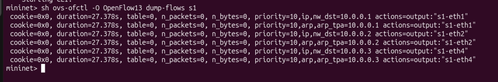 |
| 5 | D1 transfer: sender log ending in `"verdict": "PASS"` | `05_d1_pass.png` | 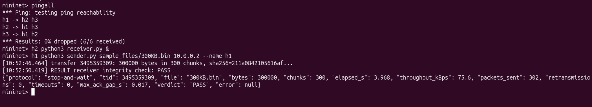 |
| 6 | `sha256sum` of original and received (identical) | `06_hash_match.png` | 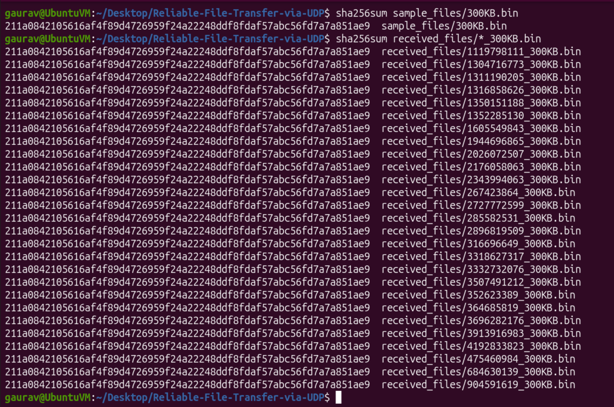 |
| 7 | 5 % loss run: `TIMEOUT` / `RETRANSMIT` lines and `PASS` | `07_loss_retransmit.png` | 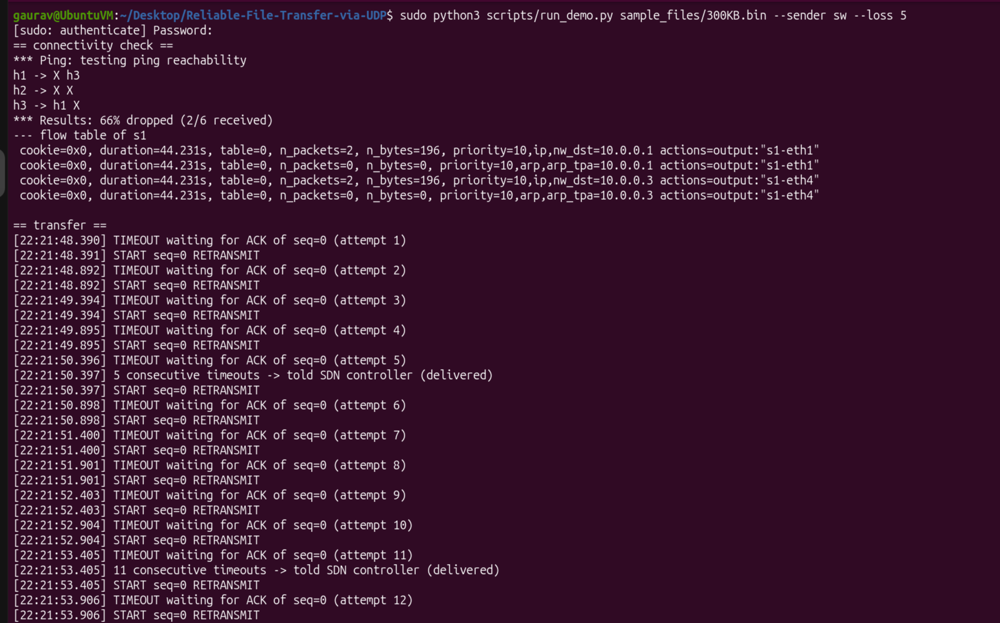 |
| 8 | Receiver log with `DUP ... re-ACK` and `GAP` lines | `08_receiver_dup_gap.png` | 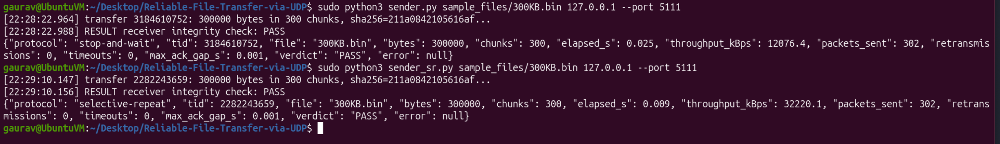 |
| 9 | Wireshark / tshark capture on `udp.port == 5005` | `09_wireshark_udp.png` | 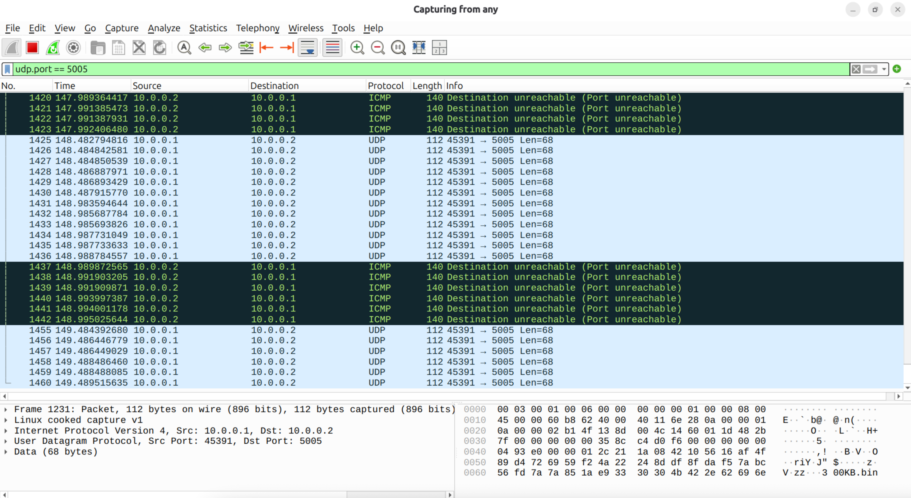 |

### D2: dynamic SDN

| # | What to capture | Suggested file | Preview |
|---|---|---|---|
| 10 | Flow table **before** failure (10.0.0.2 → `s1-eth2`) | `10_flow_before.png` | 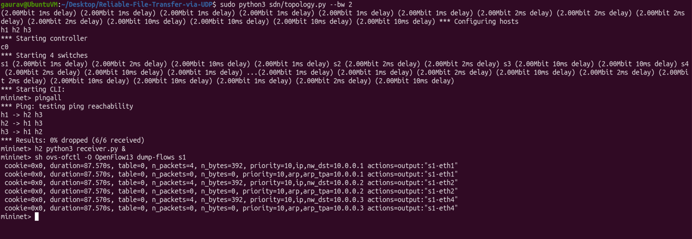 |
| 11 | T1 controller: `LINK_DOWN` + `REROUTE ... s1-s3-s4` | `11_controller_reroute.png` | 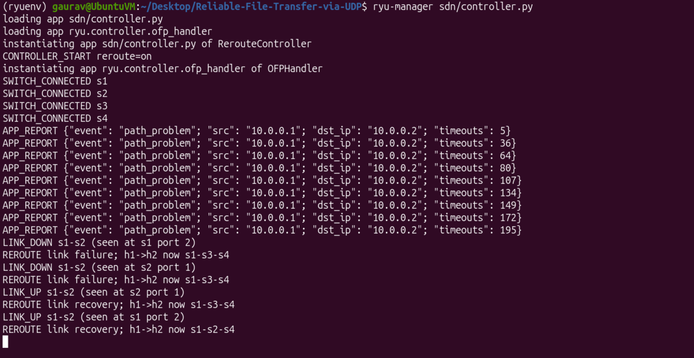 |
| 12 | Flow table **during** failure (10.0.0.2 → `s1-eth3`) | `12_flow_during.png` | 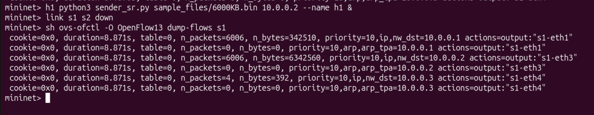 |
| 13 | tshark on `s1-eth3` showing packets on the backup route | `13_backup_capture.png` | 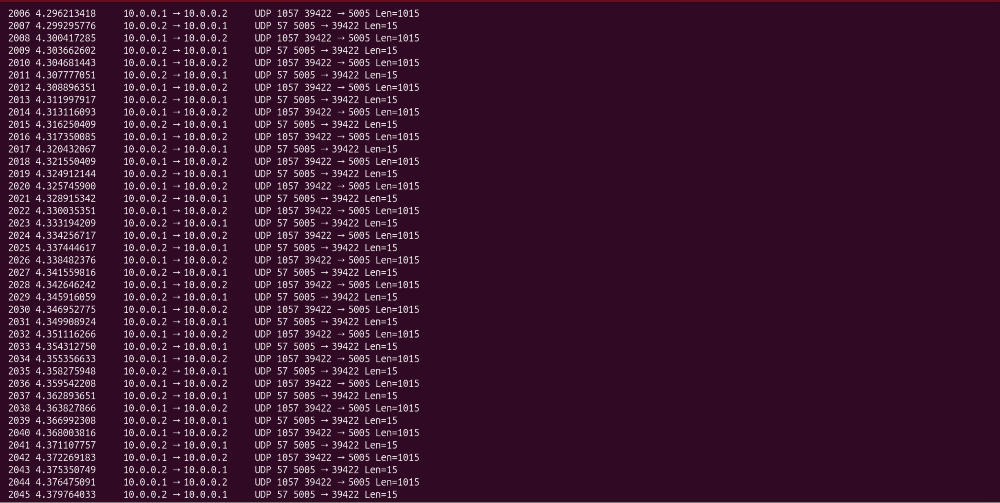 |
| 14 | Recovery: `LINK_UP` + `REROUTE ... s1-s2-s4` | `14_recovery.png` | 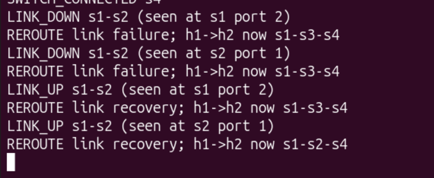 |
| 15 | Silent failure: `APP_REPORT` with no `LINK_DOWN` | `15_silent_failure.png` | 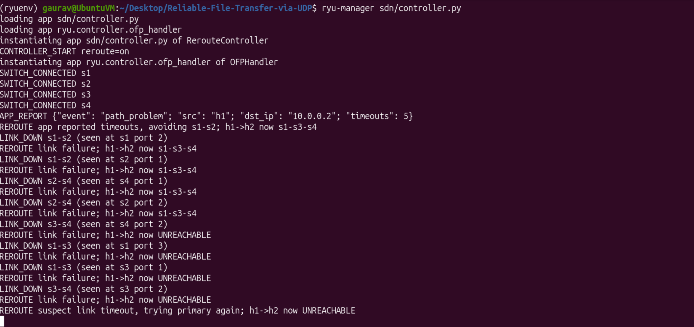 |
| 16 | Two senders at once: interleaved receiver log | `16_multi_sender.png` | 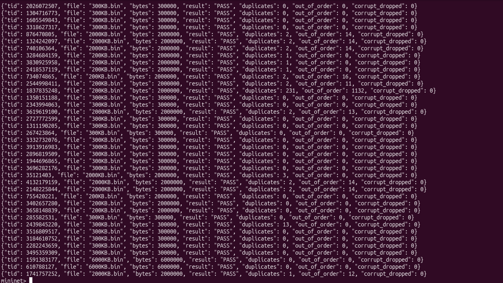 |
| 17 | `logs/controller_events.csv` with timestamps | `17_events_csv.png` | 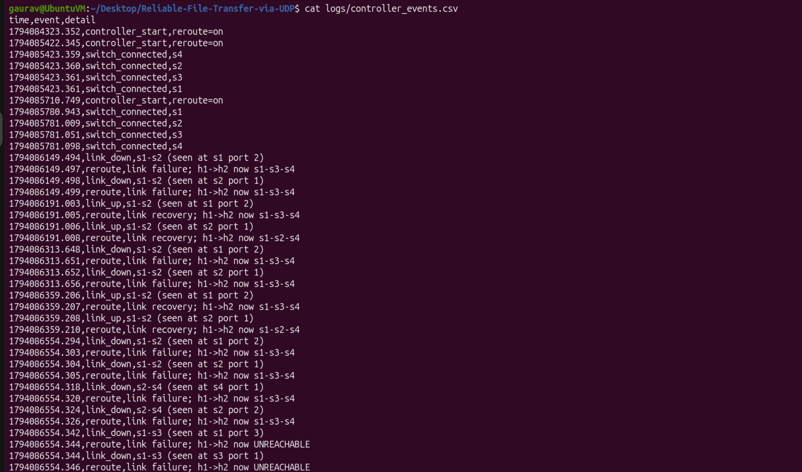 |

<!-- OPTIONAL: record a screen GIF of UC7 (T1 + T2 side by side) and add:
<p align="center"></p> -->

---

## Results

### Graphs

<!-- After running `python3 scripts/plot_results.py`, replace each placehold.co URL below with results/loss_comparison.png and results/failure_comparison.png -->
| Loss comparison | Failure comparison |
|:--:|:--:|
|  |  |
| throughput, retransmissions and time vs. loss | longest stall and total time, dynamic vs static |

### Loss experiment (300 KB, 5 Mbit, N trials)

| Loss % | Sender | Throughput (kB/s) | Retransmissions | Time (s) | Verdict |
|---:|---|---:|---:|---:|:--:|
| 0 | stop-and-wait | _fill_ | _fill_ | _fill_ | PASS |
| 0 | Selective Repeat | _fill_ | _fill_ | _fill_ | PASS |
| 2 | stop-and-wait | _fill_ | _fill_ | _fill_ | PASS |
| 2 | Selective Repeat | _fill_ | _fill_ | _fill_ | PASS |
| 5 | stop-and-wait | _fill_ | _fill_ | _fill_ | PASS |
| 5 | Selective Repeat | _fill_ | _fill_ | _fill_ | PASS |
| 10 | stop-and-wait | _fill_ | _fill_ | _fill_ | PASS |
| 10 | Selective Repeat | _fill_ | _fill_ | _fill_ | PASS |

### Failure experiment: dynamic SDN vs static baseline

| Controller | Sender | `max_ack_gap_s` (longest stall) | Total time (s) | Verdict |
|---|---|---:|---:|:--:|
| Dynamic (`--tag sdn`) | Selective Repeat | _fill_ | _fill_ | PASS |
| Static (`--tag static`) | Selective Repeat | _fill_ | _fill_ | PASS |
| Dynamic (`--tag sdn`) | stop-and-wait | _fill_ | _fill_ | PASS |
| Static (`--tag static`) | stop-and-wait | _fill_ | _fill_ | PASS |


---

## Reading the Output

<details>
<summary><b>Sender lines</b></summary>

| Line | Meaning |
|---|---|
| `DATA seq=N sent` | first transmission of chunk N (with `-v`) |
| `DATA seq=N RETRANSMIT` | chunk N sent again because its ACK did not arrive |
| `TIMEOUT waiting for ACK of seq=N (attempt K)` | no ACK within the timeout |
| `TIMEOUT K packet(s) ..., rto -> X s` | Selective Repeat timeout; timer doubled |
| `K consecutive timeouts -> told SDN controller` | application report sent |
| `RESULT receiver integrity check: PASS` | received file's hash matches |
| `TRANSFER FAILED: gave up on ...` | a packet used all retries |
</details>

<details>
<summary><b>Result JSON fields</b></summary>

| Field | Meaning |
|---|---|
| `elapsed_s` | total transfer time |
| `throughput_kBps` | file bytes ÷ elapsed time |
| `packets_sent` | every datagram sent, including retransmissions |
| `retransmissions` | datagrams sent again |
| `timeouts` | timer expiries |
| `max_ack_gap_s` | longest silence between ACKs: **the outage the application experienced** |
| `verdict` | `PASS`, `FAIL` (receiver), or `ERROR` (sender gave up) |
| `harness_verified` | hash recomputed independently by `harness.py` (experiments only) |
</details>

<details>
<summary><b>Receiver and controller lines</b></summary>

| Line | Meaning |
|---|---|
| `GAP expected seq=N, got seq=M` | a packet arrived ahead of order; N is missing |
| `DUP seq=N ignored` | repeated packet not stored again |
| `CORRUPT/malformed datagram dropped` | bad CRC/header, treated as loss |
| `FIN but K chunks MISSING` | sender finished early; no FIN_ACK |
| `INTEGRITY: PASS/FAIL ...` | final result |
| `SWITCH_CONNECTED s1` … `s4` | switch connected and has rules |
| `LINK_DOWN s1-s2` / `LINK_UP s1-s2` | switch reported the link state |
| `REROUTE link failure; h1->h2 now s1-s3-s4` | rules rewritten to the backup |
| `APP_REPORT {...}` | the application sent a warning |
</details>

### Output files

| File | Written by | Contents |
|---|---|---|
| `received_files/<tid>_<name>` | receiver | the reconstructed file, only after FIN completes |
| `logs/receiver_summary.jsonl` | receiver | one JSON line per transfer |
| `logs/controller_events.csv` | controller | `time,event,detail` |
| `logs/port_stats.csv` | D2 controller | `time,dpid,port,rx_pkts,tx_pkts,rx_bytes,tx_bytes,tx_kbps` |
| `results/experiments.csv` | `run_experiments.py` | one row per run |
| `results/*.png` | `plot_results.py` | graphs |

---

## Tests

```bash
python3 -m unittest discover tests            # all 22 tests
python3 -m unittest tests.test_protocol -v    # packet format (7)
python3 -m unittest tests.test_routing  -v    # routing and failover (7)
python3 -m unittest tests.test_loopback -v    # UDP transfers on localhost (8)
```

| Suite | Count | Covers |
|---|---:|---|
| `test_protocol` | 7 | pack/unpack, CRC, START body |
| `test_routing` | 7 | shortest path, failed links, failover |
| `test_loopback` | 8 | loss, lost ACKs, both senders, empty file, two senders at once |

---

## Reproducing on Another Machine

| # | Action | Expected result |
|---:|---|---|
| 1 | Ubuntu 20.04/22.04 with sudo | `lsb_release -a` shows version |
| 2 | Install packages | `sudo mn --test pingall` → 0% dropped |
| 3 | Python 3.9 venv + Ryu | `which ryu-manager` is in `~/ryuenv/bin` |
| 4 | Clone and enter repo | `ls` shows `receiver.py sdn scripts tests` |
| 5 | `python3 -m unittest discover tests` | `Ran 22 tests ... OK` |
| 6 | Create `sample_files/2000KB.bin` | exactly 2000000 bytes |
| 7 | Start Ryu (T1), then topology (T2) | T1 shows `s1..s4 connected` |
| 8 | `pingall` | 0% dropped (6/6) |
| 9 | `h1 ping -c 3 h2` | RTT about 12 ms |
| 10 | `dump-flows s1` | rules for 10.0.0.1, .2, .3 |
| 11 | UC5 normal transfer | hashes match |
| 12 | UC6 with 5 % loss | `PASS`, retransmissions > 0 |
| 13 | UC7 link failure | reroute lines in T1 |
| 14 | UC11 experiments | CSV rows and graphs |

---

## Troubleshooting

> Change one thing at a time and read the **first** error line, not the last. Restart in the standard order after each change.

| Symptom | Cause | Fix |
|---|---|---|
| `Unable to contact the remote controller at 127.0.0.1:6653` | Mininet started before Ryu | start Ryu first |
| `pingall` shows `100% dropped` | no rules installed (`failMode=secure`, by design) | start Ryu, restart topology |
| Ryu prints `Terminated` immediately | `sudo mn -c` ran while Ryu was up | never do that; restart Ryu |
| `PermissionError: ... logs/controller_events.csv` | Mininet created root-owned files | `sudo chown -R $USER:$USER logs received_files` |
| `ModuleNotFoundError: routing/flows/net_config` | file missing in `sdn/` or Ryu started elsewhere | run from repo root |
| `ModuleNotFoundError: ryu` | venv not active | `source ~/ryuenv/bin/activate` |
| `ImportError` for `mininet` | running under the venv | run `sudo python3 sdn/topology.py` **outside** the venv |
| `ryu-manager` fails to install | wrong Python or setuptools | Python 3.9 + `setuptools==57.5.0` |
| `head: sample_files/...: No such file` | folder not created | `mkdir -p sample_files` |
| Transfer ends before the failure command | file too small / links too fast | `--bw 2`, bigger file, later `--fail-at` |
| `TRANSFER FAILED: gave up on DATA seq=N` | outage > ~7.5 s with stop-and-wait | shorten outage, use `sender_sr.py`, or raise `MAX_RETRIES` |
| No `LINK_DOWN` after `link s1 s2 down` | switch did not report port change | `sh ovs-ofctl -O OpenFlow13 show s1`; confirm Ryu connected |
| `Address already in use` (5005 / 6653) | old run still alive | `sudo mn -c`; `pkill -f receiver.py`; `pkill -f ryu-manager` |
| `/tmp/sdn_notify.sock` errors | stale socket | `rm -f /tmp/sdn_notify.sock`, restart Ryu |
| `tshark` cannot capture `s1-eth2` | wrong interface name / network down | `ip link` while the network is up |

---

## Limitations

- **Detection is only as good as the signal.** Silent failures rely on an application report that does not name the bad link; the controller avoids the first core link of the current route (a heuristic).
- **Monitoring is recorded, not acted on.** Port stats are logged; routes do not change with load.
- **No congestion control.** The Selective Repeat window is fixed.
- **No security.** CRC32 detects accidents, not tampering; the SHA-256 in START is unauthenticated; the notify socket accepts any local process.
- **No session expiry.** The receiver keeps sessions in memory until restart.
- **Random loss.** Use multiple trials and report the spread.
- **One-sided loss by design.** Loss is applied on s1's links only.
- **Single controller, single machine.** The app → controller channel needs both on one machine.
- **Transfer-id collisions** are possible in principle (random 32-bit id).


## Team and Contributions

| Member | GitHub | Owns |
|----|---|---|
| Jahnvi Nagpal | [@jahnvinagpal-11](https://github.com/jahnvinagpal-11) | `sender.py`, `sender_sr.py`, `notify.py`, `scripts/harness.py`, `scripts/run_demo.py` |
| Gaurav Naik    | [@gitaccgaurav](https://github.com/gitaccgaurav) | `receiver.py`, `config.py`, `protocol.py`, `scripts/run_experiments.py`, `scripts/plot_results.py`, `tests/test_loopback.py`, `tests/test_protocol.py` |
| Yashwanth Sai  | [@Yashwanth-sai-code_](https://github.com/Yashwanth-sai-code) | `sdn/` (all files), `tests/test_routing.py` |

<details>
<summary><b>Git workflow</b></summary>

Files not to commit (already in `.gitignore`): `__pycache__/`, `*.pyc`, `logs/`, `received_files/`, `sample_files/*.bin`.
Keep `sample_files/.gitkeep`. Commit `results/` only after final runs.

```bash
git checkout -b my-change
python3 -m unittest discover tests
git add <changed files>
git commit -m "describe the change"
git push -u origin my-change
```

Use a branch for any change to a shared interface (`protocol.py`, `config.py`, `sdn/net_config.py`, sender output format) and tell the other members first.
</details>


---

## Acknowledgements

- [Mininet](http://mininet.org/): network emulation
- [Open vSwitch](https://www.openvswitch.org/): software switch
- [Ryu](https://ryu-sdn.org/): SDN framework
- _Computer Networks Professor / Dr. Vidhya K / PES UNIVERSITY_

<!-- OPTIONAL: add a LICENSE file and a License section here. -->

<div align="center">

**⭐ If this project helped you, consider giving the repo a star.**

</div>
